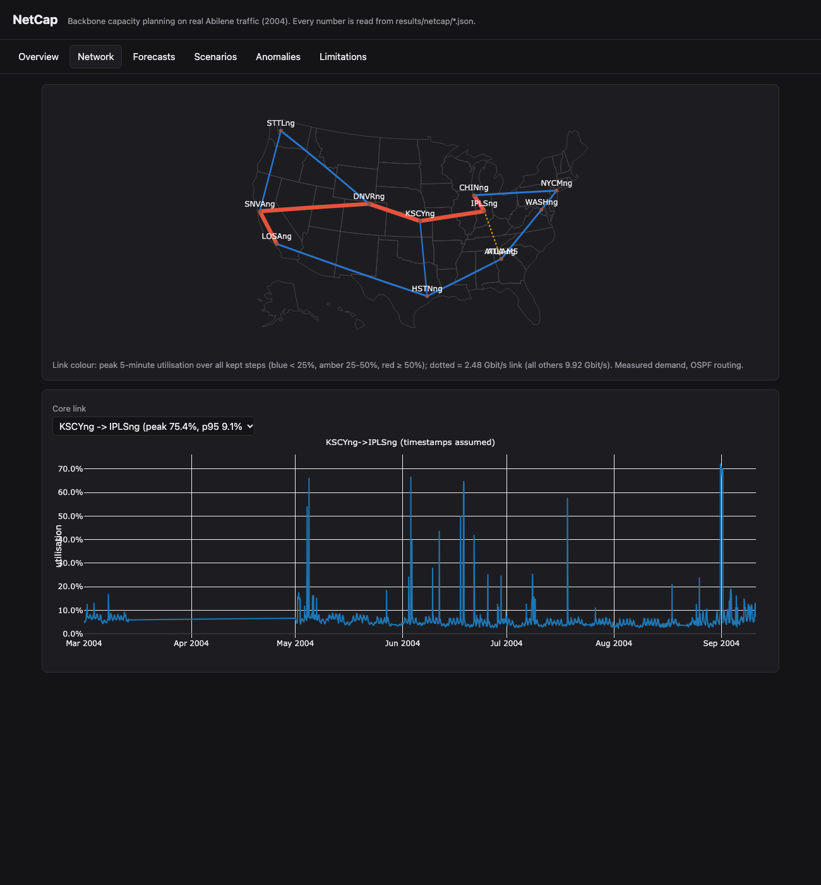
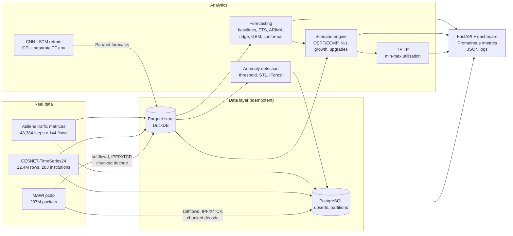
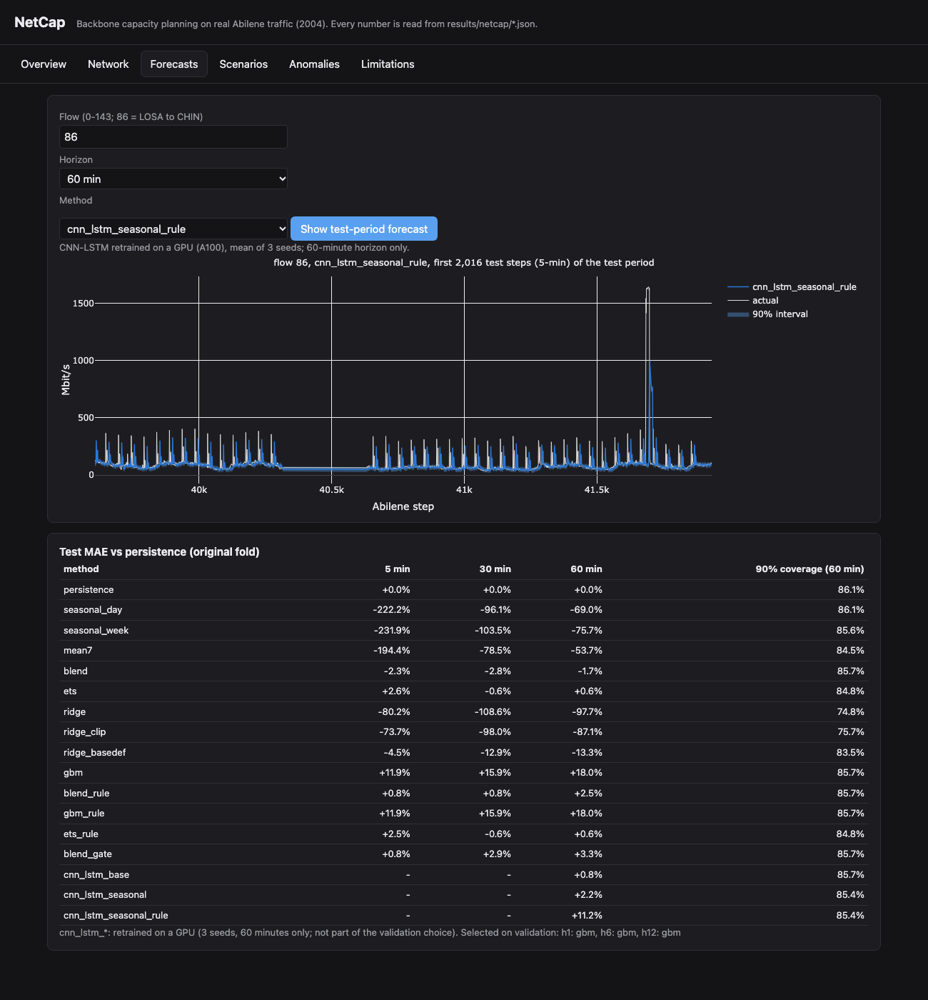
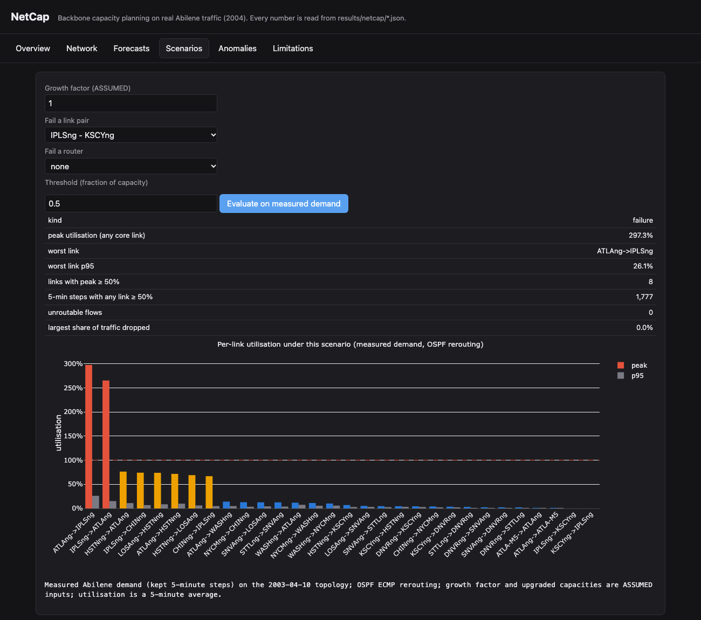
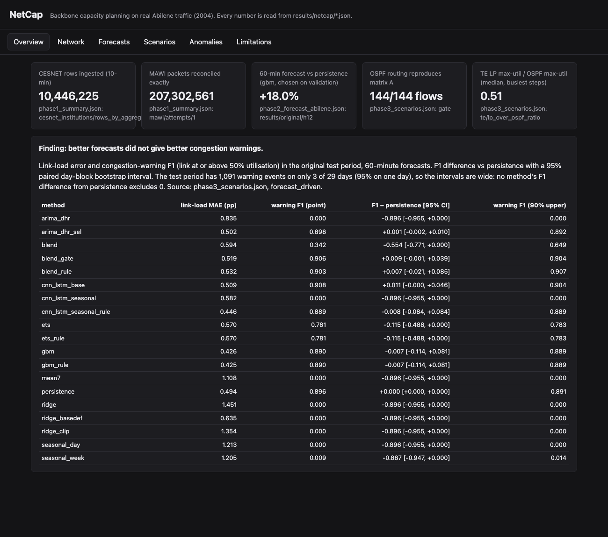

# NetCap

**Backbone capacity planning on real traffic: forecasting, failure scenarios, traffic engineering and anomaly detection, served through an API and dashboard.**

[](https://github.com/Vkartik-3/NetCap/actions/workflows/ci.yml)


**Live dashboard (static snapshot):** https://vkartik-3.github.io/NetCap/



NetCap answers the questions a capacity planner asks about a backbone: *how busy is each link, what will traffic
look like in the next hour, what breaks if a link or router fails, which upgrade fixes it, and how much better
could routing be?* It does this on measured traffic (the Abilene research backbone, 12 routers and 144
origin-destination flows at 5-minute resolution), with every number traceable to a result file that records the
command, code version, seed, date and data version.

---

## Key results

| Question | Answer | Evidence |
|---|---|---|
| Does the routing model match reality? | OSPF shortest paths with ECMP reproduce the dataset's routing matrix for **144 / 144 flows** | [`phase3_routing_gate.json`](results/netcap/phase3_routing_gate.json) |
| How well can traffic be forecast 60 minutes ahead? | A gradient-boosting model beats persistence by **+18.0%** (95% CI +14.6 to +20.3), and by +16.9 to +20.5% in three more rolling-origin folds; chosen on validation every time | [`phase2_forecast_abilene.json`](results/netcap/phase2_forecast_abilene.json) |
| What is the biggest failure risk? | Losing the IPLS–KSCY link pushes the 2.48 Gbit/s ATLA→IPLS link to **297%** of capacity | [`phase3_scenarios.json`](results/netcap/phase3_scenarios.json) |
| Which upgrade removes it? | ATLA–IPLS to 9.92 Gbit/s (assumed size): worst single failure drops to **77%**. A search over 30 single-link upgrades (assumed 2× / 4× sizes) × 28 cases (no failure + 27 single failures) finds it is **the only link whose upgrade helps**; it needs at least **9.22 Gbit/s** to stay under 80% | same, `upgrade_search` |
| What if 5-minute averages hide bursts? | After that upgrade the worst N-1 case is 77.3%, so a peak-to-average factor of just **1.035×** breaks the 80% target. At an assumed 1.2×, 26 of the 28 cases exceed 80% and reaching it again takes 14 upgrades (+126 Gbit/s per direction); at 1.5× the busiest link is over 100% even without a failure | same, `peak_factor_sensitivity` |
| How much could traffic engineering help? | The min-max-utilisation LP bound is **0.70×** OSPF's peak on a typical hour (95% CI 0.696 to 0.712) and **0.49×** under the worst failure | same (3,405 LPs per case) |
| Do neural networks beat it? | **No.** Retrained on an A100 GPU (3 seeds, 7.7 min), the best CNN-LSTM (seasonal + fallback rule) gains **+11.2%** over persistence, reproducing the published +10.8% (seed band +9.8 to +11.5), but stays below the GBM's +18.0% on the same test rows | [`phase_neural_retrain.json`](results/netcap/phase_neural_retrain.json) |
| Do better forecasts give better congestion warnings? | **No.** The most accurate model has 14% lower link-load error than persistence but a warning F1 of 0.890 vs 0.896 (difference −0.007, 95% CI −0.114 to +0.081). 95% of warning events fall on one test day, so no method's warning F1 is distinguishable from persistence. The seasonal CNN-LSTM misses **every** warning (F1 0.000: it smooths away bursts); its burst fallback restores F1 to 0.889 | [`phase3_scenarios.json`](results/netcap/phase3_scenarios.json), `forecast_driven` |
| Does the packet pipeline lose data? | **207,302,561** packets reconciled exactly across an independent pcap walk, the flow meter and 56,523,852 flow records | [`phase1_mawi_…_chunked_lowmem.json`](results/netcap/phase1_mawi_202510011400_chunked_lowmem.json) |
| Does it run as a service? | Docker Compose and Kubernetes (kind) stacks pass an end-to-end check: every endpoint 200, Postgres reachable, Prometheus scraping | [`phase6_stack_kind.json`](results/netcap/phase6_stack_kind.json) |

Full results, the phase status table and every caveat: **[docs/netcap/RESULTS.md](docs/netcap/RESULTS.md)**.

---

## Architecture



---

## What's inside

### Data layer
- Idempotent ingestion into **Parquet** (content-hashed, atomic replace, manifest) and **PostgreSQL** (COPY to staging,
  `ON CONFLICT … WHERE IS DISTINCT FROM`). A re-run changes 0 rows and 0 files, verified with row checksums.
- **CESNET-TimeSeries24** institutions: 10,446,225 rows at 10 minutes (12,405,074 over three aggregations).
- **MAWI packet trace → flow records**: softflowd exporting IPFIX over TCP to a custom collector and numpy decoder, then
  chunked aggregation with DuckDB spill. Peak memory went from 16.8 GB to **1.85 GB**.
- **Query tuning** on the 10.4M-row table: a composite B-tree takes a one-institution, one-week query from **186 ms
  to 0.37 ms**. For a month-wide aggregate the index is useless and monthly range partitions win (230 → 72 ms).

### Forecasting
- Persistence, seasonal naive, 7-day mean, blend, ETS, SARIMA-type (ARMA errors + Fourier seasonality), ridge and a
  pooled **gradient-boosting** model, all on the **same four rolling-origin folds**, at 5, 30 and 60 minutes.
- Every choice (weights, penalties, thresholds, model) is made on **validation**; test is only scored.
- **Split-conformal 90% intervals**, **Diebold-Mariano** tests and **day-block bootstrap** confidence intervals.
- Five attempts at the burst problem (one flow, LOSA→CHIN, with long out-of-range bursts), all reported.
- Also run on 283 CESNET institution series: +16.6 to +20.3% at 1 hour, +44 to +50% at 6 hours over persistence.
- **Neural retrain on a GPU** (1x A100, TensorFlow 2.21, 3 seeds, 60 minutes, original fold; `bash infra/gpu/run_retrain.sh all`):
  base CNN-LSTM +0.79%, seasonal CNN-LSTM +2.18%, seasonal + fallback rule **+11.22%** over persistence; all three
  published numbers (1.1 / 2.9 / 10.8%) fall inside the 3-seed bands (the seasonal one only because its seeds disagree).
  6 models trained in 7.7 minutes. The models reach the API only as Parquet forecasts.



### Scenario engine and traffic engineering
- NetworkX topology, OSPF shortest paths with per-router ECMP splitting, validated against ground truth.
- Growth (with labelled **assumed** rates), N-1 sweeps over all 15 link pairs and 12 routers, capacity upgrades,
  combined scenarios, stranded-traffic accounting.
- A **min-max link-utilisation linear program** (HiGHS) as a lower bound for any routing, solved hourly across the
  whole dataset with bootstrap confidence intervals.
- **Upgrade search**: every core link pair at 2× / 4× capacity (assumed sizes) against all 28 cases (no failure, 15 link
  pairs, 12 routers), ranked by worst-case utilisation reduction per Gbit/s, plus a greedy plan that minimises total
  overload above 80% and a size-free minimum capacity for the binding link (ATLA–IPLS: 9.22 Gbit/s for < 80%).
- **Peak-to-average sensitivity**: the same analysis with loads scaled by assumed burst factors 1.0 / 1.2 / 1.5 / 2.0:

  | Peak factor (assumed) | Busiest link, no failure | Worst N-1 case, today | Worst N-1 case after ATLA–IPLS → 9.92 Gbit/s | Cases ≥ 80% after it (of 28) | ATLA–IPLS needed for < 80% | Plan to get every case < 80% |
  |---|---|---|---|---|---|---|
  | 1.0 | 75.4% | 297% | **77.3%** | 0 of 28 | 9.22 Gbit/s | 2 steps, +7.44 Gbit/s |
  | 1.2 | 90.4% | 357% | 92.8% | 26 of 28 | 11.06 Gbit/s | 14 steps, +126.5 Gbit/s |
  | 1.5 | 113.0% | 446% | 116.0% | 26 of 28 | 13.83 Gbit/s | 14 steps, +126.5 Gbit/s |
  | 2.0 | 150.7% | 595% | 154.6% | 26 of 28 | 18.44 Gbit/s | 14 steps, +126.5 Gbit/s |

  Capacities in the plans are per direction; candidate sizes are coarse, so plans at 1.2-2.0 coincide.
- **Forecast-driven planning check**: each method's 60-minute forecasts are routed onto the links and scored as
  congestion warnings (link ≥ 50%), with a paired day-block bootstrap of the F1 difference to persistence.



### Anomaly detection
- Static robust-z threshold, **STL** robust residuals and **Isolation Forest**, scored against **injected** synthetic
  anomalies (spikes, level shifts, dropouts) and **weak labels** from data-quality rules (outages).
- Honest outcome: dropouts are found, spikes and level shifts mostly are not (best average precision 0.165-0.186).

### Service and operations
- **FastAPI**: topology, link series, forecasts with intervals, live scenario evaluation, TE, anomalies, results.
- **Dashboard** (Plotly, no build step): overview (warnings table with F1 intervals), network map, forecasts (including
  the GPU-trained CNN-LSTMs), scenarios, anomalies, limitations.
- **Prometheus** `/metrics`, structured JSON request logs, health checks.
- **Docker** image, **Docker Compose** (Postgres, API, Prometheus, ingest jobs), **Kubernetes** manifests (Postgres
  StatefulSet + Secret, 2 API replicas with probes and limits, NodePort, ingest Job), **GitHub Actions** CI.
- The serving path never imports TensorFlow (tested).



---

## Quick start

**Local**
```bash
python3.13 -m venv .venv && .venv/bin/pip install -r requirements.txt
.venv/bin/pytest                                   # tests needing raw data skip without it
.venv/bin/uvicorn netcap_app.api:app --port 8000   # dashboard: http://localhost:8000
```

**Docker Compose**
```bash
docker compose up -d --build db api prometheus
docker compose --profile jobs run --rm ingest-abilene     # loads raw/ into Parquet and Postgres
open http://localhost:8000        # dashboard
open http://localhost:9090        # Prometheus
```

**Kubernetes (kind)**
```bash
kind create cluster --name netcap --config infra/k8s/kind-config.yaml
docker build -f infra/Dockerfile -t netcap:1.0 . && kind load docker-image netcap:1.0 --name netcap
kubectl apply -k infra/k8s && kubectl apply -f infra/k8s/job-ingest.yaml
open http://localhost:8080
```

**Static dashboard for GitHub Pages**: `python -m netcap.report.static_site` writes `site/` (published on the `gh-pages` branch).

**Reproduce every result** (after downloading the datasets below):
```bash
python -m netcap.pipeline.ingest parquet abilene && python -m netcap.pipeline.ingest postgres abilene
python -m netcap.pipeline.ingest parquet cesnet  && python -m netcap.pipeline.ingest postgres cesnet
python -m netcap.bench.query_latency
python -m netcap.forecast.run abilene && python -m netcap.forecast.run cesnet
python -m netcap.scenario.run
python -m netcap.anomaly.run
python -m netcap.ops.quality && python -m netcap.report.summary
python -m netcap.report.static_site                 # static dashboard in site/
```

**Neural retrain** (NVIDIA GPU, Linux, Python 3.12; copy the repo and `raw/`): `bash infra/gpu/run_retrain.sh all` sets up
the TensorFlow environment, checks the GPU, runs the timing gate and the 6 models, logging every step to `logs/`. Then
re-run `netcap.scenario.run`, `netcap.report.summary` and `netcap.report.static_site` here.

---

## Repository layout

| Path | Contents |
|---|---|
| `netcap/data`, `netcap/store`, `netcap/db`, `netcap/pipeline` | Loaders, Parquet writer, Postgres schema and upserts, ingestion CLIs |
| `netcap/forecast` | Panels and folds, methods, evaluation (conformal, DM, bootstrap), runner |
| `netcap/scenario` | Routing engine, scenarios, upgrade search and peak-factor sensitivity, TE linear program, forecast-driven warnings |
| `netcap/neural`, `infra/gpu` | CNN-LSTM retrain (TensorFlow, separate environment) and the logged GPU runner |
| `netcap/anomaly` | Detectors, injection, evaluation |
| `netcap/bench`, `netcap/ops`, `netcap/report` | Benchmarks, measurement and quality tooling, summary builder, static-site export |
| `netcap_app` | FastAPI service and dashboard |
| `infra`, `docker-compose.yml`, `.github/workflows` | Dockerfile, Kubernetes manifests, Prometheus config, CI |
| `tests_netcap` | Test suite |
| `research` | Forecasting research code (`common.py`, phase scripts, CNN-LSTM models), its log, figures and TensorFlow requirements |
| `results/netcap` | Every result as JSON with provenance, plus a report per phase |
| `docs/netcap` | Results, decisions, limitations, working notes |

More detail: [docs/PROJECT_OVERVIEW.md](docs/PROJECT_OVERVIEW.md).

---

## Limitations

One link-level network (Abilene, 2004 traffic on 2003 OSPF weights; times of day are inferred); 5-minute averages
hide sub-minute bursts (the peak factors in the sensitivity table are assumed, not measured); growth rates and upgrade
sizes are assumptions; the LP is a bound, not a deployable routing; 95% of the test period's congestion warnings fall
on one day; injected anomalies are synthetic. The neural retrain covers one horizon and fold (3 seeds). Full list:
[docs/netcap/LIMITATIONS.md](docs/netcap/LIMITATIONS.md). Decisions, including every change made after seeing a
result: [docs/netcap/DECISIONS.md](docs/netcap/DECISIONS.md).

---

## Data sources

| Dataset | Source | Terms |
|---|---|---|
| Abilene traffic matrices (Y. Zhang) | https://www.cs.utexas.edu/~yzhang/research/AbileneTM/ | research dataset, no license stated |
| CESNET-TimeSeries24 (institutions) | J. Koumar, K. Hynek, T. Čejka, P. Šiška, *CESNET-TimeSeries24*, Zenodo, 2024, [doi:10.5281/zenodo.13382427](https://doi.org/10.5281/zenodo.13382427) | CC-BY-4.0 |
| MAWI Working Group Traffic Archive, samplepoint-F (WIDE Project) | https://mawi.wide.ad.jp/mawi/ | only derived aggregates are stored |

Raw data is never committed; see [docs/netcap/RESULTS.md](docs/netcap/RESULTS.md) for download and setup steps.

## License

Code: MIT (see [LICENSE](LICENSE)). The datasets keep their own terms (table above).
